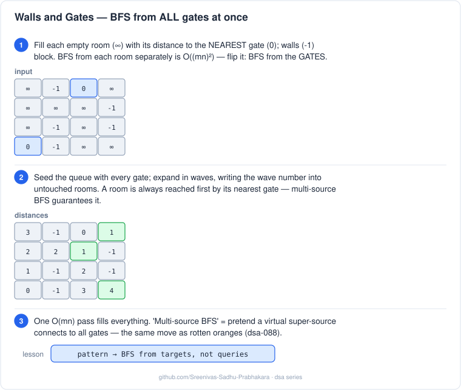

# Walls and Gates

> NeetCode 150 · Graphs — multi-source BFS from every gate at once; a room's first visit is its nearest-gate distance, and the INF check doubles as visited. Go, stdlib only, tested.

## Problem

A grid of gates (0), walls (−1) and empty rooms (INF). Fill each room with the distance to its *nearest* gate; unreachable rooms stay INF.

## Approach

Per-room BFS from each room is O((RC)²); flip the direction. Seed one BFS with **all gates simultaneously** — the same multi-source trick as Rotten Oranges (dsa-088) — and expand outward; because all sources start at distance 0, the first arrival at any room is provably from its nearest gate, so each cell is assigned exactly once. The `!= INF` guard does triple duty: wall, gate, and already-visited are all "not an unassigned room". Writing the distance *at enqueue time* (not dequeue) keeps rooms from entering the queue twice. Sealed rooms simply never get visited — the spec's unreachable case for free.

**Complexity:** O(R·C) time and queue.

## Visual walkthrough

Read the picture top to bottom — each numbered frame is one moment of the algorithm
running on this repo's test example.

## Run

    go test ./...   # verify
    go run .        # demo

---

Part of a 275-repo DSA series in Go — Striver's SDE Sheet (dsa-001–191) plus the NeetCode 150 / Blind 75 additions (dsa-192–275), stdlib only, every solution tested. Browse: [`dsa-*` repos](https://github.com/Sreenivas-Sadhu-Prabhakara?tab=repositories&q=dsa-&type=source).
